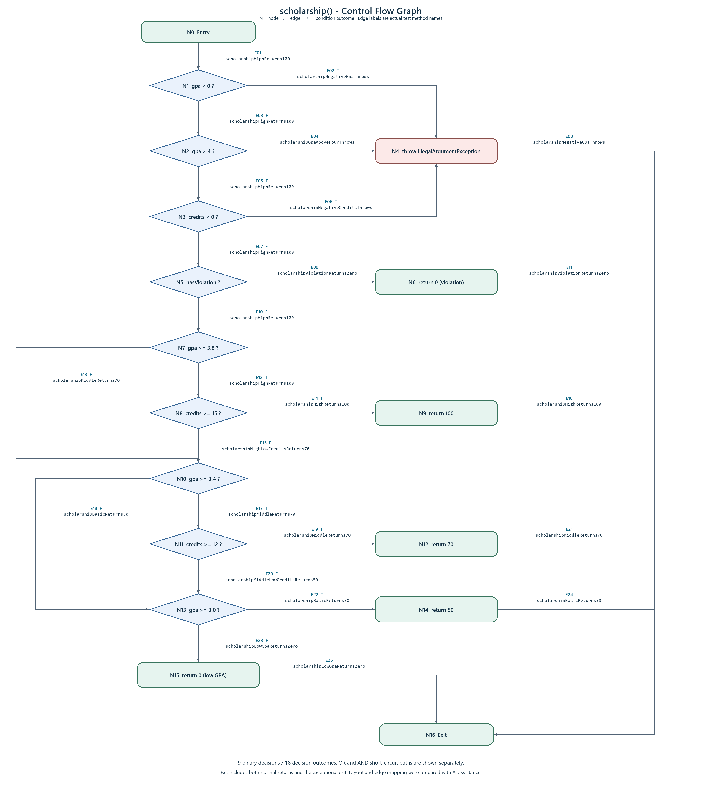

# Лаборатори 9: Код хамралт - JaCoCo

**Оюутан:** М.Мөнхгэрэлт  
**Оюутны код:** B232270012  
**Хичээл:** F.CSA313 - Программ хангамжийн чанарын баталгаа ба тест

`java -version` :

```text
openjdk version "21.0.1" 2023-10-17 LTS
OpenJDK Runtime Environment Temurin-21.0.1+12 (build 21.0.1+12-LTS)
OpenJDK 64-Bit Server VM Temurin-21.0.1+12 (build 21.0.1+12-LTS, mixed mode, sharing)
```

`mvn -version` :

```text
Apache Maven 3.9.9 (8e8579a9e76f7d015ee5ec7bfcdc97d260186937)
Maven home: C:\Program Files\apache-maven-3.9.9
Java version: 21.0.1, vendor: Eclipse Adoptium, runtime: C:\Program Files\Eclipse Adoptium\jdk-21.0.1.12-hotspot
Default locale: en_US, platform encoding: UTF-8
OS name: "windows 11", version: "10.0", arch: "amd64", family: "windows"
```

## Зорилго ба ажиллуулах орчин

`ScholarshipCalculator` классын үсгэн дүн, голч, тэтгэлэг тооцох гурван функцийг JUnit 5-аар шалгаж, JaCoCo-оор мөр болон салааны хамралтыг хэмжив. Эхлээд хэвийн оролтуудыг шалгасан, дараа нь хүрээгүй замуудад тест нэмсэн. Бүх салаа хамрагдсан хувилбар дээр зааг утгын тест нэмэхэд 60 онооны алдаа илэрсэн.

Тестийг Windows 11, JDK 21, Maven 3.9.9 орчинд ажиллуулсан. Багшийн `pom.xml` дэх Java 17 зорилтот хувилбар, JUnit Jupiter 5.10.2, JaCoCo 0.8.12, Surefire 3.2.5 тохиргоог өөрчлөөгүй.

`pom.xml` байгаа хавтаснаас:

```sh
mvn clean verify
```

Үүний дараа `target/site/jacoco/index.html` файлыг браузераар нээж тайланг үзнэ. Тестгүй starter дээр Maven амжилттай дууссан ч JaCoCo-ийн гүйцэтгэлийн өгөгдөл байхгүй тул тайлан үүсээгүй; эхний тестүүдийг нэмсний дараа тайлан гарсан.

Windows дээр ашиглах JDK-г тухайн PowerShell цонхонд сонгосон команд:

```powershell
$env:JAVA_HOME = 'C:\Program Files\Eclipse Adoptium\jdk-21.0.1.12-hotspot'
$env:Path = "$env:JAVA_HOME\bin;$env:Path"
mvn clean verify
```

Үе шат бүрийн хэмжилтэд `clean` ашигласнаар өмнөх `jacoco.exec` файл нийлж тоологдохоос сэргийлсэн. Maven гаралтыг PowerShell 7-ийн `Tee-Object` командаар UTF-8 хэлбэрээр хадгалж, үүссэн `jacoco.csv` файлыг тухайн үе шатны нэрээр хуулсан.

## Хэсэг A: Хэвийн урсгалын анхны хэмжилт

Эхний таван тест нь `letterGrade(95)`, `gpa([95, 85])`, мөн тэтгэлгийн 100, 70, 50 хувийн хэвийн тохиолдлуудыг шалгасан. [Тестийн код](src/test/java/mn/edu/must/sqat/ScholarshipCalculatorTest.java)-ын эхний таван метод энэ хэсэгт хамаарна.

Хамралтыг `covered / (covered + missed) × 100` томьёогоор тооцсон. Доорх бүх мөрийн тоо `ScholarshipCalculator` классын CSV мөрөөс, тестийн тоо Maven гаралтын сүүлийн `Tests run:` мөрөөс авсан **гүйцэтгэлийн тоо** юм; параметржүүлсэн тестийн мөр бүр тусдаа тоологдоно.

| Үе шат | Тестийн гүйцэтгэл | Line covered / total | Line хамралт | Branch covered / total | Branch хамралт | Нотолгоо |
|---|---:|---:|---:|---:|---:|---|
| A | 5 | 16 / 25 | 64.00% | 22 / 41 | 53.66% | [Maven A](results/mvn-verify-A.txt), [CSV A](results/jacoco-A.csv) |
| B | 20 | 25 / 25 | 100% | 41 / 41 | 100% | [Maven B](results/mvn-verify-B.txt), [CSV B](results/jacoco-B.csv) |
| C | 22 | 25 / 25 | 100% | 41 / 41 | 100% | [Maven C](results/mvn-verify-C.txt), [CSV C](results/jacoco-C.csv) |
| Эцсийн | 29 | 25 / 25 | 100% | 41 / 41 | 100% | [Maven final](results/mvn-verify-final.txt), [CSV final](results/jacoco-final.csv) |

A-ийн тайланд оролтын `||` шалгалтууд, `gpa()`-ийн `switch`, тэтгэлгийн `&&` нөхцөлүүд шар ромботой байсан нь зөвхөн зарим салаа нь биелснийг харуулсан. Алдаа шидэх мөрүүд, C/D/F дүн рүү очих замууд, тэтгэлэггүй буцах эцсийн мөр улаан байсан. Тухайлбал, голч хангалттай боловч кредит хүрэхгүй тохиолдол эхний тестүүдэд байгаагүй тул `&&` нөхцөлийн хоёр дахь хэсгийн худал утга шалгагдаагүй.

## Хэсэг B: CFG ба бүрэн хамралт

`scholarship()` функцийн CFG-г зангилаа болон ирмэг бүрээр нь байрлуулж, `||`, `&&` нөхцөлүүдийг богино холбоосоор үнэлэгдэх дарааллаар нь тусад нь үзүүлсэн. Жишээлбэл, `gpa >= 3.8` худал бол `credits >= 15` шалгалтад орохгүй, дараагийн тэтгэлгийн нөхцөл рүү шилжинэ.



[Зургийн бүтэн хувилбар](cfg.png), [draw.io-д засварлах эх файл](cfg.drawio). `N0-N16` нь зангилаа, `E01-E25` нь ирмэг; `T/F` нь нөхцөлийн үнэн, худал үр дүнг тэмдэглэнэ. Ирмэг бүрийн хажуу дахь нэр нь тестийн файлд байгаа бодит методын нэр бөгөөд тухайн тест тэр ирмэгийг дайрна. Нийт есөн хоёр салаатай шийдвэрийг тусад нь үзүүлсэн; 41 гэсэн JaCoCo-ийн нийт салааны тоо нь зөвхөн энэ CFG биш, бүх классын хэмжилт юм.

Бүрэн хамралтад хүрэхэд нийт **20 тестийн гүйцэтгэл** шаардлагатай болсон. B-ийн CSV файлд `LINE_MISSED = 0`, `BRANCH_MISSED = 0` байна.

| Нэмсэн шалгалт | Хамруулсан зам |
|---|---|
| `gradeOtherValidScoresReturnExpectedLetter` | 75, 65, 55 онооны C/D/F үр дүн |
| `gradeOutOfRangeThrows` | Оноо 0-ээс бага, 100-аас их гэсэн хоёр алдааны зам |
| `gpaAllGradeCategoriesReturnsTwo` | A/B/C/D болон F-д харгалзах `default` салаа; үр дүн 2.0 |
| `gpaNullThrows`, `gpaEmptyThrows` | `null`, хоосон массивын тусдаа алдааны замууд |
| `scholarshipNegativeGpaThrows` | Эхний `||` нөхцөлийн `gpa < 0` үнэн |
| `scholarshipGpaAboveFourThrows` | `gpa > 4` үнэн |
| `scholarshipNegativeCreditsThrows` | `credits < 0` үнэн |
| `scholarshipViolationReturnsZero` | Сахилгын зөрчилтэй оюутанд тэтгэлэг олгохгүй |
| `scholarshipHighLowCreditsReturns70` | Голч 3.9 боловч 12 кредит тул 100 биш, 70 буцна |
| `scholarshipMiddleLowCreditsReturns50` | Голч 3.5 боловч 11 кредит тул 70 биш, 50 буцна |
| `scholarshipLowGpaReturnsZero` | Голч 2.9 тул тэтгэлэггүй |

## Хэсэг C: Давталтын 0 / 1 / 2+ зааг

| Давталт | Тестийн нэр | Оролт ба хүлээлт |
|---|---|---|
| 0 | `gpaNullThrows` | `null` оролтод `IllegalArgumentException` |
| 0 | `gpaEmptyThrows` | `[]` оролтод `IllegalArgumentException` |
| 1 | `gpaOneGradeReturnsFour` | `[95]` үед 4.0 |
| 2+ | `gpaFourGradesReturnsTwoPointFive` | `[95, 85, 75, 65]` үед 2.5 |

0 удаагийн тохиолдлуудыг B хэсэгт нэмсэн тестээр дахин ашиглаж, C хэсэгт нэг ба дөрвөн дүнтэй хоёр тест нэмсэн. `null`, хоосон массив нь `for` давталтад орохоос өмнө алдаа шиддэг.

Салааны хамралт 100% болсон ч энэ үзүүлэлт давталтыг яг хэдэн удаа ажиллуулсныг ялгаж хэмждэггүй тул 0, 1, олон элементийн зан төлөвийг тусад нь шалгах хэрэгтэй. Эдгээр тест нь хоосон оролтын хамгаалалт, нэг дүнгийн үр дүн, олон дүнгийн нийлбэр ба хуваалтыг баталдаг учраас хамралтын хувь өсөөгүй ч ач холбогдолтой.

## Хэсэг D: Хамралтад харагдаагүй заагийн алдаа

`gradeBoundaryReturnsExpectedLetter` параметржүүлсэн тестэд дараах долоон зааг утгыг нэмсэн:

| Оноо | Спецификацийн хүлээлт |
|---:|---|
| 60 | D |
| 59.99 | F |
| 69.99 | D |
| 0 | F |
| 100 | A |
| 89.99 | B |
| 90 | A |

Засвар хийхээс өмнөх [бодит уналтын гаралт](results/mvn-test-D-fail.txt)-д 29 тестээс нэг нь унасан:

```text
ScholarshipCalculatorTest.gradeBoundaryReturnsExpectedLetter(double, String)[1]
org.opentest4j.AssertionFailedError: expected: <D> but was: <F>
Tests run: 29, Failures: 1, Errors: 0, Skipped: 0
BUILD FAILURE
```

`score > 60` нөхцөл яг 60 дээр худал болж, `F` буцааж байсан. Харин классын толгойн спецификацид D үнэлгээ 60-аас эхэлнэ гэж заасан тул [эх кодын](src/main/java/mn/edu/must/sqat/ScholarshipCalculator.java) ганц харьцуулалтыг зассан:

```diff
-        if (score > 60)  return "D";
+        if (score >= 60) return "D";
```

Засварын тусдаа commit: **`f99ad86`**, `Fix letterGrade: > 60 to >= 60, specification says 60 is D`. Энэ commit зөвхөн дээрх эх кодын өөрчлөлтийг агуулна; алдааг гаргасан тест болон унасан лог нь өмнөх `92f69c1` commit-д хадгалагдсан. `pom.xml` болон бусад логикийг өөрчлөөгүй.

Засварын дараах [эцсийн гаралт](results/mvn-verify-final.txt):

```text
Tests run: 29, Failures: 0, Errors: 0, Skipped: 0
BUILD SUCCESS
```

[Эцсийн CSV](results/jacoco-final.csv)-д 25 мөр, 41 салаа бүгд хамрагдсан, `LINE_MISSED` ба `BRANCH_MISSED` хоёул 0 байна. D-ийн унасан үед `mvn test` ажиллуулсан тул тэр гаралтыг шинэ хамралтын тайлан гэж ашиглаагүй; засварын дараа `clean verify` ажиллуулж тайланг шинээр гаргасан.

### Гол дүгнэлт

Салааны хамралт 100% болсон нь нөхцөл бүрийн боломжит гарцыг тест дайрсныг харуулдаг боловч гарц руу хуваарилсан утгууд зөв гэдгийг баталдаггүй. Энэ ажилд 65 оноо D, 55 оноо F болохыг шалгасан учраас `score > 60` нөхцөлийн хоёр салаа аль хэдийн хамрагдсан байсан. Гэтэл яг 60 оноог шалгаагүй тул `>` болон `>=` хоёр операторын ялгаа өмнөх тестүүдэд илрээгүй. 60 оноонд D хүлээсэн заагийн тест нэмэхэд л спецификацийн зөрүү харагдсан. Иймээс хамралтын тайланг хүрээгүй замаа олоход ашиглаж, тестийн оролт болон хүлээгдсэн үр дүнг шаардлага, зааг утгын шинжилгээгээр давхар сонгох хэрэгтэй гэж үзэв.

## Ажлын түүх ба AI ашигласан хүрээ

Starter, A-ийн хэвийн тест ба хэмжилт, B-ийн бүрэн хамралт ба CFG, C-ийн давталтын зааг, D-ийн унасан тест, D-ийн эх кодын засварыг ажлын явцад тус тусад нь commit хийсэн. Нотолгооны файлуудыг тухайн үе шатанд Maven-аар бодитоор үүсгэж хадгалсан; A/B/C-ийн хуучин үр дүнг эцсийн тестүүдээр сольж бичээгүй.

AI туслахыг тестийн код бэлтгэх, Maven ажиллуулж үр дүнг хадгалах, CSV тооцоог шалгах, CFG-ийн зангилаа ба ирмэгийг байрлуулах, тайлангийн найруулгад ашигласан. CFG нь AI-ийн тусламжтай бэлтгэсэн, байрлалыг нь тус бүрээр тодорхойлсон зураг бөгөөд оюутан өөрөө цаасан дээр гараар зурсан зураг гэж тайлбарлаагүй. Тестийн оролт, хүлээлтийг starter-ийн спецификацитай тулгаж, алдааны мөрийг бодит уналтын логтой харьцуулсан.

`target/`, `.idea/`, `.DS_Store`, `*.iml` нь `.gitignore`-д орсон. Багшийн зааврын `.docx`, starter архив, хөрвүүлэлтийн гаралт репозиторид ороогүй.
